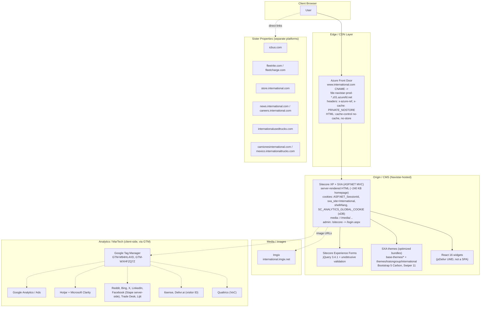

# International Trucks (Navistar) — Current State Web Architecture (Observed)

_Reverse-engineered from public, client-side evidence only (response headers, cookies, DNS, bundle paths,
`robots.txt`, sitemap). No internal documentation or credentials were used. Last observed: 2026-10-17._

## Diagram

## Component Notes & Evidence

| Layer | Component | Role | Evidence |
|---|---|---|---|
| Edge | **Azure Front Door** | Global entry point / routing to Navistar origin. HTML is not cached at the edge | `dig`: `www` CNAME `fde-navistar-prod-*.z01.azurefd.net`; `x-azure-ref`, `x-cache: PRIVATE_NOSTORE`, `cache-control: no-cache, no-store` |
| Origin | **Sitecore XP + SXA** | CMS, page rendering, personalization/analytics (xDB), forms | `ASP.NET_SessionId`, `__RequestVerificationToken`, `SC_ANALYTICS_GLOBAL_COOKIE`, `sxa_site=International`, `shell#lang`; `/-/media/` paths; `/sitecore modules/Web/ExperienceForms/`; `/layouts/system/VisitorIdentification.js`; `/bundles/international?v=` (ASP.NET bundling) |
| Origin | **SXA themes** | Optimized, rev-hashed theme bundles | `/-/media/base-themes/{main-theme,core-libraries-navistar,xa-api,searchtheme,swiperslider,resolve-conflicts}/...`; site theme `themes/tratongroup/international/international` |
| Admin | **Sitecore login** | CM access protected by redirect | `/sitecore/login` -> 302 `/login.aspx?ReturnUrl=/sitecore/login`; `robots.txt` disallows `/sitecore` |
| Front end | **Bootstrap 5, jQuery 3.4.1, Swiper 11, React 16** | UI framework and widgets | Bundle paths; `react@16`, `react-dom@16` from `cdn.jsdelivr.net` |
| Media | **Imgix** | Image CDN / transformation | 47 references to `international.imgix.net` in homepage HTML |
| i18n | **Language paths + sister domains** | `/fr/` has its own sitemap; `/es-pa/` disallowed; Mexico on separate domain | `robots.txt` (`Sitemap: /fr/sitemap.xml`, `Disallow: /es-pa/*`); links to `camionesinternational.com` |
| MarTech | **GTM and tag vendors** | Analytics, heatmaps, ads, visitor ID, VoC | Two GTM containers; CSP `connect-src`/`script-src` allow-lists (Reddit, Bing, Clarity, Hotjar, Trade Desk, Lijit, LinkedIn, Facebook/Stape, 6sense, Qualtrics, Delivr.ai) |
| Security | **CSP** | Allow-list policy | `content-security-policy` header; `script-src` includes `'unsafe-inline'` and `'unsafe-eval'` |

## Interpretation

International's site is a **classic monolithic Sitecore XP/SXA implementation** fronted by Azure Front Door:

- **Every page view is rendered at the origin.** HTML is `no-cache, no-store`, so Front Door acts as a
  router/TLS terminator rather than a page cache. Time to first byte and Core Web Vitals are therefore tied
  to Sitecore's origin performance and to a ~240 KB HTML document.
- **Front-end stack is dated but conventional:** jQuery 3.4.1 (from Experience Forms), React 16 (end-of-life,
  loaded from a public CDN for isolated widgets), and Bootstrap 5 with SXA theme bundles.
- **Marketing technology is heavy and tag-driven.** Two GTM containers load 15+ vendors client-side; Sitecore
  xDB tracking is also active. This is a likely contributor to main-thread cost.
- **The brand is a federation of separate properties** (parts, fleet services, used trucks, news, careers,
  store, Mexico) with no evidence of a shared header/footer service or content layer.
- **Third-party/agency involvement:** the theme namespace (`tratongroup`) suggests an implementation partner.

## Open Questions (not confirmable from client-side evidence alone)

- Sitecore version, hosting (Azure VMs/PaaS vs. on-prem), and whether Sitecore is scaled as CM/CD roles.
- Backend integrations behind dynamic features: dealer locator, truck/spec configurator, parts search,
  lead forms (CRM/marketing automation target — no Eloqua/Marketo/HubSpot script was visible).
- Whether search is Sitecore-native (SXA `searchtheme`) or backed by an external engine.
- Whether `store.international.com` and `icbus.com` share SSO, content, or product data with the main site.
- How `/fr/` and `/es-pa/` are authored (Sitecore language versions vs. separate sites).
- Authentication: no login flow was observed on the public site.
