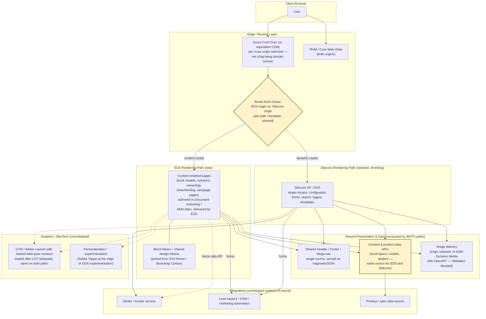

# International Trucks (Navistar) — Future State Web Architecture (Proposed)

_Companion to `current-state-architecture.md`. This is a directional target architecture, not a committed
roadmap — every component marked "Validation Needed" requires a proof of concept or technical spike before it
can be treated as a decision. Drafted 2026-10-17._

_Framing note: International's public site is a content-heavy Sitecore XP/SXA monolith with no sign of an
entrenched headless investment. That makes a **progressive, route-by-route migration** the right shape:
Edge Delivery Services (EDS) takes over content-oriented pages first, while Sitecore keeps serving the
dynamic/transactional routes until each one is deliberately replaced or retained. Nothing here requires a
big-bang cutover, and no decision is made about the Sitecore-backed integrations (dealer locator, configurator,
forms) until they are inspected._

## Diagram

This diagram deliberately does **not** say which pages move first beyond the content-vs-dynamic principle.
The routing split is per path or template and is decided during discovery.

## What Changes vs. Current State

| Target Component | Replaces / Evolves | Rationale | Validation Needed | Proof Point Needed |
|---|---|---|---|---|
| **EDS for content-oriented pages** | Sitecore server-rendered pages (`no-cache, no-store` HTML, ~240 KB homepage) | Static, edge-cached delivery with near-perfect Lighthouse scores; removes origin rendering from the critical path for the highest-traffic marketing pages | Confirm the content model (truck models, features, specs) can be expressed as EDS blocks/spreadsheets or AEM Sites content fragments; confirm authors can work in DA or Universal Editor | Migrate 3-5 representative pages (home, a truck model page, a solutions page, a news page) and compare Lighthouse/CWV vs. current |
| **Edge-level routing (EDS vs. Sitecore)** | One origin (Sitecore) behind Azure Front Door for all paths | Enables phased migration with instant rollback per route and keeps dynamic features working untouched | Confirm Azure Front Door rules (or an edge worker) can route by path with no URL change; confirm cookies/session on dynamic paths are unaffected | Route one path prefix (e.g. `/trucks/`) to EDS while the rest stays on Sitecore; verify SEO, canonicals, sitemap and analytics parity |
| **Shared header / footer / nav** | Header/footer rendered by SXA renderings per site, and separately maintained on sister properties | One source of truth across EDS, Sitecore and (optionally) sister sites such as parts, fleet and used trucks | Confirm nav source (Sitecore content tree today) can be exported as JSON/HTML fragment and consumed by an EDS block and a Sitecore rendering | Build the nav as a fragment service; render it in an EDS block and in a Sitecore page on a test path |
| **Content & product data layer** | Data embedded in Sitecore items and SXA components | Truck specs/model data surfaced identically to both paths; avoids authoring twice during the transition | Identify authoritative sources for specs, models, trim levels and dealer data; confirm API availability and licensing | One EDS block and one Sitecore rendering reading the same spec endpoint |
| **Tag/MarTech consolidation** | Two GTM containers loading ~15 vendors in the page head/body | Reduces main-thread cost; one data-layer contract across both paths; opportunity to delay non-critical tags | Inventory tags with owners; confirm which are still in use (e.g. duplicate heatmaps: Hotjar and Clarity) | Move non-critical vendors behind a post-LCP/consent trigger on the EDS path and compare INP/TBT |
| **Personalization & experimentation** | Sitecore xDB/personalization | Edge-based personalization and A/B testing without origin rendering | Confirm whether xDB personalization rules are actually in use; define the audiences worth preserving | Run one experiment (e.g. hero variant) on an EDS page and compare to Sitecore baseline |
| **Image delivery** | Imgix (47 references on the homepage) | Imgix works fine with EDS; may be kept to limit migration scope | Decide whether to keep Imgix or move to AEM Dynamic Media with OpenAPI / EDS native image optimization | Render the same hero in both and compare weight/LCP |
| **Modern front-end baseline** | jQuery 3.4.1, React 16 from CDN, Bootstrap 5 Carbon | Removes end-of-life libraries from migrated pages; ships vanilla JS blocks | Inventory which Sitecore widgets depend on jQuery/React 16 and must remain until retired | Confirm migrated pages ship no jQuery/React |
| **Security posture** | CSP with `'unsafe-inline'` and `'unsafe-eval'` | A tighter CSP becomes feasible on EDS pages once inline tag scripts are reduced | Confirm tag vendors can run under a nonce/hash-based policy | Deploy a report-only strict CSP on the EDS path |

> **Highlighted rows in the diagram (Routing, Data layer) need discussion.** They are the least validated and
> highest-impact items.

## Sequencing Notes (draft, for discussion)

1. **Discovery spike (1-2 weeks):** inventory Sitecore templates, traffic by path, authoring workflows, and the
   integrations behind the dealer locator, configurator and forms. This decides the content-vs-dynamic split.
2. **Pilot migration:** 3-5 high-traffic content pages on EDS (with the shared header/footer), served from a
   staging path, with Lighthouse/CWV comparison against production Sitecore.
3. **Edge routing pilot:** route one path prefix to EDS in production behind Azure Front Door; validate SEO
   (canonicals, sitemap, redirects), analytics parity and rollback.
4. **Shared nav and data layer:** stand up the header/footer fragment and a spec/model API so both origins
   consume them; this can run in parallel with step 3.
5. **MarTech consolidation:** tag inventory and delayed loading on the EDS path; evaluate consolidation of the
   two GTM containers.
6. **Scale-out:** migrate remaining content templates in waves; retire Sitecore templates only when traffic on
   them reaches zero. Decide per dynamic feature whether to rebuild as an EDS block or leave on Sitecore.

## Explicit Non-Goals / Open for Debate

- This document does **not** claim Sitecore is retired. Dynamic features stay on Sitecore until each one is
  inspected and a replacement is justified.
- This document does **not** specify which sister property (parts, fleet, used trucks, Mexico, store) joins the
  shared header/footer or EDS; that is a later decision.
- This document does **not** prescribe the authoring tool (Document Authoring vs. AEM Sites with Universal
  Editor); it depends on author profile and governance needs.
- Backend systems of record (dealer, CRM, spec data, commerce for the store) are assumed unchanged.
